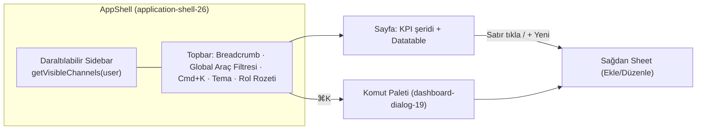

# 🎨 TRUSS UI/UX v2 — Shadcn Studio Pro Dönüşüm Blueprint'i

> **İlke:** Mevcut mantık katmanı (Backend, servisler, store'lar, utils, `channelAccess.js`) olduğu gibi kalır, yalnızca arayüz değişir.
> **Kaynak:** `shadcn-studio-mcp` canlı katalog taraması, style `radix-luma` (projenin `components.json` dosyasından okundu).
> **Durum:** FAZ 1, yani keşif ve plan. Henüz hiçbir blok kurulmadı.

---

## 0. 🚨 Önce çözülmesi gereken engel: Tailwind v3 ile v4 uyumsuzluğu

| Kanıt | Bulgu |
|---|---|
| `package.json` | `tailwindcss: ^3.4.19` |
| `components.json` | `style: radix-luma`. Bu, shadcn'in Tailwind **v4** için çıkardığı yeni nesil stil. |
| `src/components/ui/*.jsx` | Mevcut bileşenler zaten v4 sınıfları kullanıyor (`data-slot`, `shadow-xs`, `outline-hidden`). |
| `index.css` | v4'e özgü `@import "shadcn/tailwind.css"` satırı var. Bu dosya v4'ün `@theme inline` direktifini içeriyor. |
| **Derlenmiş CSS (`dist/`)** | `.shadow-xs` **0** kez, `.outline-hidden` **0** kez geçiyor. `@theme` ise CSS'e **ham ve işlenmemiş** olarak düşmüş. |

**Sonuç:** Mevcut shadcn bileşenleri şu an bile kısmen stilsiz render ediliyor. Pro bloklar da v4 sınıflarıyla yazıldığı için olduğu gibi kurulursa **görsel olarak bozuk** çıkar ve sorunun kaynağını bulmak zor olur.

> [!CAUTION]
> **Öneri: Blok kurulumundan önce "FAZ 0: Tailwind v4 Geçişi" yapılmalı** (`@tailwindcss/vite`, `@theme` ile TRUSS renk değişkenlerinin tanımlanması). Bu adım atlanırsa sonraki 17 adımın tamamı tutarsız bir CSS zemini üzerine kurulur. **Onayın gerekiyor (Bölüm 10).**

---

## 1. Keşif Özeti

| Kategori | Taranan | Uygun bulunanlar |
|---|---|---|
| Application Shell | 32 | `application-shell-26` ⭐, `-19`, `-23` |
| Dashboard Sidebar | 12 | `dashboard-sidebar-11` (lojistik). Shell-26'nın kendi sidebar'ı yeterli olduğu için seçilmedi. |
| Statistics / KPI | 28 | `statistics-component-01` ⭐ (lojistik), `-18` ⭐ (segmentli dağılım çubuğu), `-25` (rol özeti) |
| Charts | 65 | `chart-component-46` ⭐ (kategori kırılımlı aylık harcama), `-63` (bütçe/gerçekleşen), `-31` |
| Datatable (10 aile) | ~60 | `datatable-example-03` ⭐ (**Filo yönetimi**), `-filtering-02` ⭐, `-example-05` ⭐, `-editing-01` ⭐ |
| Dashboard Dialog | 37 | `dashboard-dialog-19` ⭐ (Cmd+K), `-22` ⭐ (silme onayı), `-36` ⭐ (**rol ve yetki sheet'i**) |
| Form Layout | 14 | `form-layout-01` (2 sütunlu ızgara düzeni) |
| Widgets | 28 | `widget-component-12` ⭐ (**araç durumu**), `-17` (zaman çizelgesi) |
| Map Blocks | 2 | `map-blocks-02` (**canlı filo takibi**, MapLibre). Faz 3'e bırakıldı (Bölüm 11). |
| Empty State | 12 | `empty-state-07` |

- Seçilen blokların hiçbiri `notIncludedInYourPlan` listesinde değil. **Hepsi lisans kapsamında.**
- `radix-luma` için kurulamayan tek bölüm **Bento Cards** (yalnızca `base-*` stillerinde var). Bu bölüme zaten ihtiyacımız yok.

---

## 2. Bilgi Mimarisi ve Rotalar

Mevcut 5 kanal, 5 ayrı rotaya bölünüyor. Her rota `channelAccess.js` içindeki **mevcut** kanal anahtarlarından birine bağlanıyor. Dosyanın kendisi değişmiyor.

| Ekran | Rota | `channelAccess` anahtarı | DRIVER görür mü? |
|---|---|---|---|
| Genel Bakış | `/app` | `horizon` (herkese açık) | ✅ Görür. **Finansal widget'lar** ise ayrıca `analytics` ile korunur. |
| Filo / Araçlar | `/app/filo` | `horizon` | ✅ Görür (yalnızca zimmetli araçları; filtreyi Backend uyguluyor) |
| Yakıt & Bakım | `/app/hareketler` | `ledger` | ✅ Görür |
| Parça Ömür Matrisi | `/app/parcalar` | `components` | ✅ Görür |
| Ekip & Yetki | `/app/ekip` | `crew` | ❌ Görmez (`yetkiler.ekip` bayrağı varsa görür) |



**Global Araç Filtresi:** Topbar'daki araç seçici, `useVehicleStore.seciliAracId` / `setSeciliAracId` değerini **olduğu gibi** kullanır. Bu alan store'da zaten var. Seçim tüm tablolara otomatik uygulanır ve seçili araç breadcrumb'da `Filo › 34 ABC 123` biçiminde görünür.

---

## 3. Ekran Bazlı Blok Seçimi

### 3.1 Uygulama Kabuğu: `application-shell-26` (Pro)
**Neden bu blok:** Kenar çubuğu ikon şeridine daralabiliyor, ⌘K arama tetikleyicisi, 3 seviyeli breadcrumb, tema değiştiricili hesap menüsü ve içerik için yuvarlatılmış çerçeve hazır geliyor. Taradığım 32 kabuk içinde istediğin "daraltılabilir sidebar + temiz topbar + Cmd+K" düzenine birebir uyan tek seçenek bu.

| Blokta olan | TRUSS'ta karşılığı |
|---|---|
| Markalı başlık (ikonlu) | İkonsuz `TRU` + mor `SS` yazı logosu |
| Platform navigasyonu | `getVisibleChannels(user)` sonucundan üretilen 5 kanal |
| Active Projects grubu (renkli halkalar) | **Kritik Araçlar** grubu: bakımı geçmiş veya belgesi bitmek üzere olan araçlar (`aracDurum.js` içindeki `evrakRiskliMi` / `hesaplaBakimDurumu` ile) |
| AI Credits kartı | **Kaldırılacak.** İleride plan ve kullanım kartı için yer hazır kalacak. |
| Hesap menüsü | Ad, e-posta, **rol rozeti**, tema, çıkış (`useAppStore.handleLogout`) |

Bağımlılık: `motion`, `kbd`, `sidebar`, `toggle-group`.

### 3.2 Genel Bakış (Dashboard ve Uyarılar)
| Bölüm | Blok | Veri | Erişim |
|---|---|---|---|
| KPI şeridi (4 kart) | `statistics-component-01` (ücretsiz, **lojistik temalı**) | Aktif araç · Kritik bakım · Yaklaşan belge (15 gün) · Bu ay toplam gider | Gider kartı `analytics` ile korunur |
| Belge uyum durumu | `statistics-component-18` | Muayene / Sigorta / Kasko için **Geçerli / Yaklaşıyor / Süresi Dolmuş** dağılımı | Herkes |
| Maliyet grafiği | `chart-component-46` (Pro) | Aylık toplam gider. Üzerine gelince **Yakıt / Bakım / Parça** kırılımı görünür (km başına toplam sahip olma maliyeti vizyonunun ilk adımı). | `analytics` |
| Filo sağlığı | `widget-component-12` (ücretsiz, **araç durumu**) | Kalan bakım ömrü yüzdesi (dairesel), araç başına durum rozeti | Herkes |
| Boş durum | `empty-state-07` | "İlk aracınızı ekleyin" ve Araç Ekle Sheet'i | Herkes |

### 3.3 Filo / Araçlar: `datatable-example-03` (ücretsiz)
**Neden bu blok:** Katalogda doğrudan **"Fleet management datatable"** olarak tanımlı. Şoför bilgisi, önem derecesine göre renklenen uyarı rozetleri, ilerleme göstergesi, kolon tipine göre filtre çubuğu, satır menüsü, toplu seçim ve sayfalama hazır geliyor. Alan eşlemesi neredeyse birebir.

| Kolon | Kaynak | Not |
|---|---|---|
| Plaka + Marka/Model/Yıl | `plaka`, `marka`, `model`, `yil` | `formatTurkishPlate` |
| Sayaç | `getGuncelSayac` + `getSayacBirimi` | `tabular-nums`, birim **KM/SMH** rozeti |
| Zimmetli şoför | Admin kullanıcı listesindeki `zimmetli_araclar` verisinden eşlenir | Avatar + ad, yoksa "—" |
| Belge uyarıları | `muayene_tarihi`, `sigorta_tarihi`, `kasko_tarihi` | Bloğun önem derecesi rozetleri: 🔴 süresi dolmuş, 🟡 15 günden az kaldı |
| Bakıma kalan | `hesaplaBakimDurumu` | Bloktaki "yakıt seviyesi" çubuğu → **bakım ömrü çubuğu** |
| Aksiyonlar | Düzenle (Sheet), Detay, Sil (`dashboard-dialog-22`) | Rol kontrolü: DRIVER için yalnızca Detay |

**Sheet: Araç Ekle/Düzenle.** Bölümler: Kimlik (plaka, kategori, marka/model/varyant) · Sayaç (tip, güncel değer) · Belgeler (3 tarih, hepsi `<TrussDatePicker/>`) · Bakım periyotları. Backend 422 dönerse (geri sarma veya tip kilidi) hata **ilgili alanın altında** gösterilir (bkz. Bölüm 4).

### 3.4 Yakıt & Bakım Hareketleri: `datatable-filtering-02` (ücretsiz)
**Neden bu blok:** Katalogdaki adı "Invoice management". Gider kaydı yapısı faturayla aynı: tarih, tutar ve durum. Çoklu seçimli filtre, arama, sayfa boyutu ve en önemlisi **satır kopyalama** özelliği var. Satır kopyalama, **"Son kaydı tekrarla"** aksiyonuna dönüşecek. Sahada aynı aracı her hafta aynı istasyonda dolduran şoför için en hızlı yol bu.

- Üstte sekmeler: **Tümü / Yakıt / Bakım**, bunlar `tabs.jsx` ile.
- Kolonlar: Tarih · Araç · Tür · Sayaç (`tabular-nums`) · Litre veya Bakım tipi · Tutar (₺, `formatCurrency`) · Not.
- Satıra tıklanınca **Düzenle Sheet'i** açılır. Sayaç alanında 422 gelirse hata satır içinde görünür ve izin verilen aralık ipucu verilir ("İzin verilen aralık: 10.500 – 11.000 km"). Bunun için mevcut `parseSayacHatasi` ve `SayacHatasi.jsx` kullanılır.
- Filtreler: Araç (global filtreyle senkron) · Tür · Tarih aralığı (iki adet `TrussDatePicker`).

### 3.5 Parça Ömür Matrisi: `datatable-example-05` (Pro)
**Neden bu blok:** Satır sabitleme bu ekran için kritik. **"Değişim Gerekli" durumundaki parçalar otomatik olarak tablonun en üstüne sabitlenir.** Ayrıca durum filtresi, kolon görünürlüğü ve onaylı arşiv aksiyonu geliyor.

- Tablonun üstünde: `statistics-component-18` ile **Optimal / Yaklaşıyor / Kritik** dağılım şeridi.
- Kolonlar: Parça · Araç · Son değişim (sayaç + tarih) · Aralık · **Kalan ömür çubuğu** (`progress.jsx`, iyi/uyarı/kritik renkleri) · Maliyet (₺) · Not.
- **Sheet: Parça Ekle/Düzenle.** Alanlar: parça adı, araç, son değişim sayacı, aralık, tarih (`TrussDatePicker`), maliyet, notlar. 422 hatası satır içinde gösterilir.
- Omnibar'ın doğal dil ayrıştırıcısı kaldırılmıyor, **Cmd+K içine taşınıyor** (bkz. 3.7).

### 3.6 Ekip & Yetki: `datatable-editing-01` (Pro) + `dashboard-dialog-36` (Pro)
**Neden bu bloklar:** `editing-01` katalogda "kullanıcı tablosu, hücre içinde rol açılır menüsü" olarak tanımlı; rol değişikliği satır içinde yapılıyor. `dialog-36` ise doğrudan **"roles and permissions side sheet"**.

- Tablo: Ad/E-posta · Rol (hücre içi seçim; kendi satırı ve SYSTEM_ADMIN satırları kilitli) · Zimmetli araçlar · Yetki özeti · Aksiyonlar.
- **Yetki Sheet'i** (`dialog-36`): 6 anahtar (`yakit`, `bakim`, `finans`, `zimmet`, `envanter`, `ekip`) gruplanmış kartlar halinde. Her kartta açıklama ve rol şablonu çipi var.
- **Zimmet Sheet'i:** Araç seçimi ve yalnızca DRIVER rolündeki kullanıcılar. 409 ve 422 hataları anlaşılır mesajlarla gösterilir.
- **Yeni Üye Sheet'i:** Mevcut üç adımlı akış (oluştur → rol → yetki) korunur. Hangi adımın başarısız olduğu açıkça bildirilir.

### 3.7 Cmd+K Komut Paleti: `dashboard-dialog-19` (ücretsiz)
- **Hızlı İşlemler:** Yakıt Ekle · Bakım Ekle · Parça Ekle · Araç Ekle. Her biri ilgili Sheet'i açar. Liste `canAccessChannel` ile filtrelenir.
- **Git:** 5 ekran ve plakaya göre araç arama (seçince global filtre ayarlanır).
- **"Doğal Dil" modu (isteğe bağlı):** Eski Omnibar ayrıştırıcısı burada yaşamaya devam eder. Örneğin "34ABC fren balatası 85000 km 4500 TL" yazılınca **önceden doldurulmuş Parça Sheet'i** açılır. Böylece ileri seviye kullanıcı özelliği kaybolmaz, sadece zorunlu olmaktan çıkar.

---

## 4. Ortak Kalıp: Sheet ve Satır İçi 422 Hatası

| Kural | Ayrıntı |
|---|---|
| Kabuk | Mevcut `sheet.jsx` üzerine `AppSheet` sarmalayıcısı. Sağdan açılır, masaüstünde `sm:max-w-lg`, mobilde tam genişlik. |
| Form düzeni | `form-layout-01` bloğundaki 2 sütunlu ızgara. Bölüm başlıkları; footer sabit (İptal / Kaydet). |
| Kaydedilmemiş değişiklik | Form değiştirilmişken kapatılmaya çalışılırsa `dashboard-dialog-22` ile "Değişiklikler kaybolacak" onayı. |
| Tarih | **Yalnızca `<TrussDatePicker/>`.** Bloklarla gelen `calendar` ve `popover` tabanlı tarih seçicileri değiştirilir. |
| 422 | `parseSayacHatasi(err)` sonucu: `alanHatasi` ve `ipucu` ilgili input'un altına yazılır. Input'a `sayacInputSinifi` ve `sayacAria` uygulanır. Toast **gösterilmez**. |
| 403 | Toast'u `api.js` zaten gösteriyor. Sheet içinde **ikinci bir toast gösterilmez**. |
| Kaydetme sonrası | Sheet kapanır, tablo yenilenir, kısa bir başarı toast'u çıkar. |

---

## 5. Next.js / TSX → Vite / JSX Dönüşüm Kuralları

| # | Kural |
|---|---|
| 1 | Kurulum **tek blok** halinde yapılır: `collect_selected_blocks` (1 blok) → `get_add_command_for_items` (`style: "radix-luma"`) → komut çalıştırılır. MCP'nin `/cui` iş akışı **otomatik özelleştirme modunda kullanılmaz** (Next.js'e özgü rota dosyaları üretir ve yapıya dokunmayı yasaklar). |
| 2 | `components.json` içinde `tsx: false` olduğu için CLI TS dosyalarını JSX'e çevirir. Elle dönüşüm gerekirse tipler, `type`/`interface` tanımları, `as` ve `satisfies` ifadeleri ile generic'ler silinir. |
| 3 | Blokla gelen `app/<blok>/page.tsx` dosyası **yalnızca demo veri kaynağıdır**. Kolon tanımları okunduktan sonra silinir. Bileşen `src/components/shadcn-studio/blocks/<blok>/` altında kalır. Sayfalar `src/pages/v2/*.jsx` altında oluşturulur. |
| 4 | `"use client"` satırları silinir. `next/link` yerine `react-router-dom` `Link`, `next/navigation` yerine `useNavigate` / `useLocation`, `next/image` yerine `` kullanılır. |
| 5 | `hooks/use-pagination.ts` dosyası `src/hooks/` altına (JS olarak) taşınır. `@/` alias'ı zaten tanımlı. |
| 6 | CLI mevcut bir UI bileşeninin üzerine yazmak isterse `truss-date-picker.jsx` dosyasında **ASLA** kabul edilmez. Diğerlerinde önce fark (diff) kontrol edilir. |
| 7 | Mock veri dizileri silinir. Veri **yalnızca** mevcut servis ve store'lardan gelir (`aracService`, `yakitService`, `bakimService`, `parcaService`, `adminService`, `useVehicleStore`). |
| 8 | Bloklarla gelen `sonner` toast'ları **`react-hot-toast`** ile değiştirilir (`api.js` bunu kullanıyor; iki toast sistemi birlikte olmaz). |
| 9 | `@tanstack/react-table@8.21.3` ve `motion` yeni bağımlılık olarak kabul edilir. Başka bağımlılık eklenecekse önce onay alınır. |

---

## 6. TRUSS Marka Kimliği Kuralları

| Öğe | Kural |
|---|---|
| **Logo** | İkonsuz yazı logosu: `TRU` (`text-foreground`) + `SS` (`text-primary`, mor), `font-bold tracking-tight`. Daraltılmış ikon şeridinde `T` + mor `S` monogramı **(öneri, onayın gerekiyor)**. |
| **Renk değişkenleri** | FAZ 0'da `@theme` içinde shadcn'in semantik değişkenleri TRUSS değişkenlerine bağlanır: `--background → --truss-bg`, `--card/--popover → --truss-surface`, `--primary/--ring → --truss-purple`, `--border/--input → --truss-border`, `--muted-foreground → --truss-muted`, `--chart-1..5 →` mor tonları. **Bloklara tek tek renk yazılmaz.** Bloklar `bg-card`, `text-primary` gibi semantik sınıflarla TRUSS temasını kendiliğinden alır. |
| **Kesintisiz koyu tema** | Sidebar arka planı içerik alanıyla aynıdır (`--sidebar → --truss-bg`). Bölgeler yalnızca `border` ile ayrılır, ikinci bir zemin tonu kullanılmaz. Hem açık hem koyu temada test edilir. |
| **Sayılar** | Tüm sayısal hücre ve KPI'larda `tabular-nums` kullanılır. Sayısal kolonlar sağa hizalanır. Biçimlendirme yalnızca `formatters.js` ile yapılır. |
| **Tarih** | Yalnızca `<TrussDatePicker/>`. Her adımın sonunda kontrol: `grep -r "components/ui/calendar" src/pages/v2 src/components/shadcn-studio` sonucu **boş** olmalı. |
| **Rol rozeti** | Topbar'da ve hesap menüsünde. Yönetici rolleri `primary` (mor) dış çizgi, DRIVER `muted`. |
| **Erişim koruması** | Navigasyon `getVisibleChannels(user)` sonucundan üretilir. Rotalar `<ChannelGuard channel="...">` ile korunur (`canAccessChannel` çağırır, yetki yoksa `/app` sayfasına yönlendirir). Finansal widget'lar `canAccessChannel(user,'analytics')` ile sarmalanır. |

---

## 7. Session 1 Uygulama Sırası (her adımda tek blok)

| Adım | Blok | Çıktı | Gate |
|---|---|---|---|
| **F0** | — (altyapı) | Tailwind v4 geçişi, TRUSS `@theme` eşlemesi, mükerrer `button.js`/`.jsx`, `input.js`, `select.js`, `label.js`, `switch.js` dosyalarının temizliği | S4: build + eski Chrono ekranlarının görsel kontrolü |
| **S1** | `application-shell-26` | `AppShell`, `/app/*` rotaları, sidebar (`channelAccess`), breadcrumb, global araç filtresi, rol rozeti, tema | S3: erişim ve marka denetimi |
| **S2** | `dashboard-dialog-22` + (bloksuz) `AppSheet` | Ortak Sheet, form ızgarası, kaydedilmemiş değişiklik onayı | S4: build |
| **S3** | `datatable-example-03` | Filo tablosu | S3: alan envanteri |
| **S4** | (Sheet) | Araç Ekle/Düzenle Sheet'i + 422 | S4: 422 senaryoları (QA verisi) |
| **S5** | `datatable-filtering-02` | Hareketler tablosu (sekmeler + "Son kaydı tekrarla") | S3 |
| **S6** | (Sheet) | Yakıt/Bakım Sheet'i + kronolojik sınır ihlali için satır içi 422 | S4 |
| **S7** | `datatable-example-05` | Parça matrisi (kritik parçalar üste sabitlenir) | S3 |
| **S8** | `statistics-component-18` | Parça dağılım şeridi (Genel Bakış'ta da kullanılacak) | S4 |
| **S9** | (Sheet) | Parça Ekle/Düzenle Sheet'i | S4 |
| **S10** | `datatable-editing-01` | Ekip tablosu (hücre içi rol değişikliği, kilitler) | S3: yetki yükseltme denetimi |
| **S11** | `dashboard-dialog-36` | Yetki Sheet'i + Zimmet Sheet'i | S4: 403/409/422 |
| **S12** | `statistics-component-01` | Genel Bakış KPI şeridi | S3 |
| **S13** | `chart-component-46` | Maliyet grafiği (`analytics` korumalı) | S3 + Backend P0 kapatılmış olmalı |
| **S14** | `widget-component-12` | Filo sağlığı widget'ı | S4 |
| **S15** | `dashboard-dialog-19` | Cmd+K paleti + doğal dil modu | S4 |
| **S16** | `empty-state-07` | Tüm ekranlar için boş durumlar | S4 |
| **S17** | — | **Geçiş:** `/` → `/app`, Chrono'nun kaldırılması (QA onayından sonra) | S3: final denetim |

> [!IMPORTANT]
> Chrono, **S17'ye kadar dokunulmadan** çalışmaya devam eder. v2, yan rotada (`/app`) geliştirilir. Herhangi bir adımda sorun çıkarsa kullanıcı etkilenmez.

---

## 8. Hazır Promptlar

### 8.1 Session 1 — F0 (onay sonrası ilk iş)
```text
GÖREV F0: Tailwind v4 geçişi ve TRUSS tema eşlemesi. Blok KURMA. Yalnızca altyapı.
YASAK: Backend/, src/services/*, src/store/*, src/utils/*, src/pages/ChronoBeta/channelAccess.js dosyalarına DOKUNMA.

SORUN: Proje Tailwind 3.4 kullanıyor, ancak components.json style'ı radix-luma (v4) ve src/components/ui/* zaten v4 sınıfları içeriyor. dist CSS'te .shadow-xs ve .outline-hidden üretilmiyor, @theme ham kalıyor.

1. Resmî araçla geçiş: `npx @tailwindcss/upgrade` çalıştır, ardından Vite için @tailwindcss/vite eklentisine geç (PostCSS tailwind eklentisini kaldır). tailwind.config.js'teki truss-* renkleri, gölgeleri ve fontları index.css içindeki @theme bloğuna taşı. Mevcut truss-* sınıf adları (bg-truss-bg, text-truss-purple vb.) AYNEN çalışmaya devam etmeli; Chrono ekranları bozulmamalı.
2. shadcn semantik değişkenlerini TRUSS değişkenlerine bağla (açık ve koyu tema için ayrı ayrı):
   --background→--truss-bg, --card/--popover→--truss-surface, --primary/--ring→--truss-purple, --border/--input→--truss-border, --muted-foreground→--truss-muted, --sidebar→--truss-bg (kesintisiz tema), --chart-1..5→ mor tonları (açıktan koyuya). --primary-foreground beyaz olsun.
3. src/components/ui altında mükerrer dosyalar var: button.js+button.jsx, ayrıca tek .js uzantılı input.js, select.js, label.js, switch.js. Tüm importları tara; tek bir .jsx sürümünde birleştir, kullanılmayanı sil. Import yollarını uzantısız bırak.
4. Doğrulama: npm run build. dist CSS'te `.shadow-xs` ve `.outline-hidden` sayısı > 0 olmalı, ham `@theme` = 0 olmalı. Chrono'nun 5 kanalını açık ve koyu temada tek tek aç; bozulan ekran varsa listele.
Rapor: değişen dosyalar, build çıktısı, grep sonuçları, görsel regresyon listesi.
```

### 8.2 Session 1 — Blok adımı şablonu (S1–S16, her adımda tek blok)
```text
GÖREV S<N>: <BLOK_ADI> → <HEDEF EKRAN/BİLEŞEN>. Kaynak: UI_V2_BLUEPRINT.md bölüm <3.x>.
YASAK: Backend/, src/services/*, src/store/*, src/utils/*, channelAccess.js, src/pages/ChronoBeta/* (Chrono S17'ye kadar canlı kalacak).

1. KURULUM (yalnızca bu blok): shadcn-studio-mcp → collect_selected_blocks(add, "<BLOK_ADI>") → get_add_command_for_items(style:"radix-luma") → komutu bir kez çalıştır. /cui otomatik özelleştirme akışını KULLANMA. Üzerine yazma sorusu gelirse: truss-date-picker.jsx için HAYIR; diğerlerinde önce diff'e bak.
2. DÖNÜŞÜM (blueprint bölüm 5): TSX→JSX, "use client" sil, next/* → react-router-dom, sonner → react-hot-toast, mock diziler → mevcut servis/store. app/<blok>/page.tsx yalnızca kolon/demo referansıdır; okuduktan sonra sil.
3. MARKA (blueprint bölüm 6): Yalnızca semantik renk sınıfları; tüm sayılarda tabular-nums; tarih için yalnızca TrussDatePicker; rol ve erişim için channelAccess.
4. ALAN ENVANTERİ: Blueprint'teki kolon/alan tablosunun TAMAMI ekranda olmalı. Eksik alan varsa raporla; uydurma alan ekleme.
5. HATA UX'i: 422 → parseSayacHatasi ile satır içi; 403 → kendi toast'unu gösterme (api.js gösteriyor).
6. npm run build + kontrol: `grep -rn "components/ui/calendar\|from 'sonner'\|next/" src/pages/v2 src/components/shadcn-studio` → boş olmalı.
Rapor: kurulan dosyalar, silinen demo dosyaları, alan envanteri tablosu, build sonucu.
```

### 8.3 Session 3 — Her blok adımından sonra denetim
```text
ROLÜN: Baş Denetçi (kod yazmaz). S<N> adımını UI_V2_BLUEPRINT.md'ye göre denetle.
1. YASAK BÖLGE: git diff --stat içinde Backend/, src/services, src/store, src/utils, channelAccess.js veya src/pages/ChronoBeta değişikliği var mı? Varsa P0.
2. ALAN KAYBI: Blueprint'teki alan tablosu ile Chrono'daki eşdeğer ekranın gösterdiği alanları karşılaştır. Chrono'da olup v2'de olmayan alanları listele.
3. MARKA: Hardcoded renk (hex, bg-zinc-*, text-purple-*) var mı? tabular-nums eksik sayısal hücre var mı? TrussDatePicker dışında tarih seçici var mı? sonner/next importu kaldı mı?
4. ERİŞİM: Yeni rota/aksiyon canAccessChannel ile korunuyor mu? DRIVER'ın göremeyeceği aksiyon DOM'da görünüyor mu?
5. HATA UX'i: 422 satır içinde mi gösteriliyor? 403'te çift toast riski var mı?
Çıktı: P0/P1/P2 tablosu + "Sonraki adıma geçilebilir mi? EVET/HAYIR".
```

### 8.4 Session 2 — Paralel Backend paketi (UI'dan bağımsız, **S13'ten önce bitmeli**)
```text
MİKRO-PAKET R1 / SADECE 1 DOSYA: Backend/routes/raporRoutes.js
Q-1 denetiminin P0 bulgusu: /api/raporlar/* rotaları yalnızca authMiddleware ile korunuyor; DRIVER doğrudan API isteğiyle maliyet verilerini okuyabiliyor.
Tüm rapor rotalarına şu kuralı uygula: SYSTEM_ADMIN veya FLEET_MANAGER rolü, YA DA req.user.yetkiler.finans === true (Frontend channelAccess 'analytics' kuralıyla birebir aynı). Bunu dosya içinde küçük bir requireFinanceAccess middleware'i ile yap. Rol veya yetki yoksa 403 { code:'FORBIDDEN_INSUFFICIENT_ROLE', message }. req.user yoksa 401 TOKEN_MISSING.
Diğer dosyalara dokunma. node --check ile doğrula.
```
Ardından önceki operasyondan kalan sıra devam eder: **MP-4R → MP-6 → MP-7 → MP-8** ve Q-1'in P1 maddeleri (bakım ve yakıt controller'larındaki `toISOString` kalıntıları, JWT fallback, `qaSeed` prod koruması, `org_id=NULL` backfill).

---

## 9. Kabul Kriterleri (v2 yayına hazır sayılması için)
- [ ] Chrono'daki 5 ekranın tüm veri alanları v2'de mevcut (S3 alan envanteri ile imzalı)
- [ ] Hiçbir ekranda akordeon yok; ekleme ve düzenleme yalnızca Sheet ile yapılıyor
- [ ] 422 hataları satır içinde gösteriliyor, 403'te tek toast çıkıyor
- [ ] DRIVER ile giriş: Ekip ekranı ve finansal widget'lar DOM'da yok; API seviyesinde de 403 dönüyor (R1 paketi)
- [ ] Açık ve koyu temada hardcoded renk yok, sayılarda `tabular-nums` var, tarih seçici yalnızca `TrussDatePicker`
- [ ] `npm run build` uyarısız; Lighthouse erişilebilirlik puanı ≥ 95 (Sheet'lerde focus trap ve aria-invalid)

---

## 10. ✅ Onaylanan Kararlar (23.11.2026)
1. **FAZ 0 Tailwind v4 geçişi:** ONAY.
2. **`/app` altında paralel geliştirme:** ONAY. Chrono S17'ye kadar canlı kalacak.
3. **Daraltılmış menü logosu:** ONAY. `T` + mor `S`, ikonsuz monogram.
4. **"Son kaydı tekrarla":** ONAY. İş kuralı:
   - Kopyalanan alanlar: araç, tür, yakıt tipi veya bakım tipi, litre.
   - `tarih` alanı **bugün** (TR saati) olarak gelir.
   - **Sayaç (KM/SMH), tutar/maliyet ve not alanları BOŞ açılır**, kullanıcı doldurur. Böylece eski sayacın kopyalanması ve buna bağlı 422 hatası ya da yanlış veri riski ortadan kalkar.
   - Kayıt otomatik oluşturulmaz. Yalnızca önceden doldurulmuş Sheet açılır.

## 11. 🔭 Vizyon: Faz 3'e Bırakılanlar
| Özellik | Blok | Ön koşul |
|---|---|---|
| **Canlı Filo Haritası** | `map-blocks-02` (kamyon/motosiklet işaretçileri, rota, filtrelenebilir araç listesi) | Konum verisi (GPS/telematik entegrasyonu ya da şoför mobil check-in) |
| **Bütçe / Gerçekleşen** | `chart-component-63` | Araç ve kategori bazında aylık bütçe tablosu (Backend) |
| **Bakım Takvimi** | `event-calendar` (Ay/Hafta/Ajanda) | Muayene, sigorta, kasko ve bakım tarihlerinin tek takvimde gösterilmesi |
| **Rol Özet Kartları** | `statistics-component-25` | Ekip ekranının üst kısmı için |
